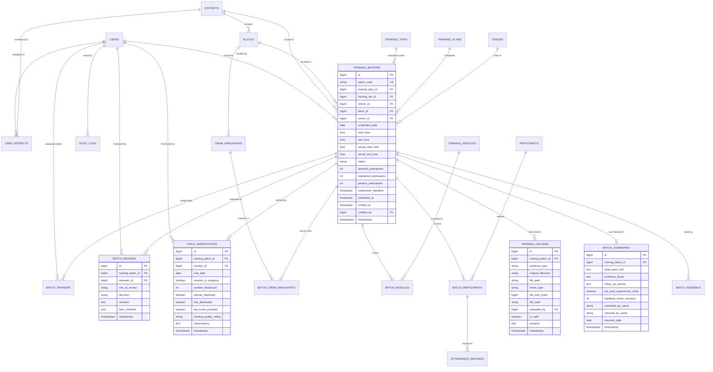

# OSDP MIS Portal - Database Architecture & Schema Design
**Odisha State Data Policy 2.0 Management Information System**

---

## 1. Schema Design Principles

1. **Third Normal Form (3NF):** High normalization to eliminate data anomalies while using strategic denormalization (e.g., cached attendance counts) where needed for high-throughput reporting.
2. **Referential Integrity:** Strict foreign key constraints with indexed lookup columns across all administrative boundaries.
3. **Auditability & Traceability:** Soft deletes (`deleted_at`) on critical master and operational tables to avoid accidental loss, alongside `created_by` and `updated_by` user references.
4. **Data Isolation & Multi-Tenancy by Geographic Scope:** Foreign keys linking records to `district_id`, `block_id`, and `gram_panchayat_id` to enforce record-level authorization.
5. **Private Evidence Separation:** Decoupled metadata storage for uploaded binary files from core business records with UUID-based path hashing.

---

## 2. Entity Relationship Diagram (ERD)

---

## 3. Table Catalog & Schema Specifications

### 3.1 Authentication & Scope
- `users`: Core authentication identity (Name, Email, Phone, Designation, Status, Password, Last Login At, IP).
- `user_districts`: Association table mapping District Coordinators and Monitors to specific districts.
- `roles`, `permissions`, `model_has_roles`, etc.: Spatie RBAC tables.

### 3.2 Master Data Tables
- `districts`: 30 districts of Odisha (ID, Name, District Code, State, Is Active).
- `blocks`: 314 blocks of Odisha (ID, District ID FK, Name, Block Code, Is Active).
- `gram_panchayats`: Gram Panchayats (ID, Block ID FK, Name, GP Code, Is Active).
- `training_tiers`: Directorate, District, Block, Gram Panchayat, Citizen Awareness (ID, Code, Name, Target Duration Hours, Target Batch Size).
- `training_modules`: Modules 1 through 8 (ID, Module Number, Code, Title, Description, Topics JSON, Is Active).
- `venues`: Approved physical training venues (ID, District ID FK, Block ID FK, Name, Address, Capacity, Facilities JSON, Is Active).

### 3.3 Programme & Batch Scheduling
- `training_plans`: Master training plan containers (ID, Title, Financial Year, Start Date, End Date, Target Batches, Target Participants, Status).
- `training_batches`: The operational core entity (ID, Batch Code, Plan ID, Tier ID, District ID, Block ID, Venue ID, Dates, Timings, Actual Timings, Status, Counts, Created By).
- `batch_trainers`: Pivot table mapping Primary & Co-Trainers to Batches (ID, Batch ID, User ID / Trainer ID, Role: Primary/Co-Trainer, Attendance Confirmed).
- `batch_gram_panchayats`: Mapping cluster batches to multiple Gram Panchayats (ID, Batch ID, Gram Panchayat ID).
- `batch_modules`: Modules delivered during the session (ID, Batch ID, Module ID).

### 3.4 Participants & Attendance
- `participants`: Master participant register (ID, Full Name, Designation, Department, Office / GP, Phone Masked, Email).
- `batch_participants`: Batch enrollment record (ID, Batch ID FK, Participant ID FK, Attendance Type).
- `attendance_records`: Form 2 transcription (ID, Batch Participant ID FK, Batch ID FK, Morning Present, Afternoon Present, Marked By FK, Remarks).

### 3.5 Evidence & Workflow
- `training_uploads`: Stores the six mandatory evidence items (Attendance Sheet, Photo 1, Photo 2, Video, Feedback PDF, Form 3 PDF). Tracks evidence type, storage path, size, MIME type, SHA-256 hash, and upload timestamp.
- `batch_summaries`: Form 3 Part C training summary (Successes, Issues, Follow-up, Assessment Done, Actual Counts).
- `batch_feedback`: Participant feedback evaluation aggregation and individual metric ratings (Q1 to Q5 scores: 1 to 5).
- `batch_reviews`: Workflow decisions (`approved`, `correction_requested`, `rejected`) with structured remarks and reviewer ID.
- `field_verifications`: Independent Field Monitor on-site observation records.

### 3.6 System & Compliance
- `audit_logs`: Detailed activity history (Actor, Entity Type, Entity ID, Action, Old Values JSON, New Values JSON, IP, User Agent).
- `system_settings`: Configurable operational variables (Submission Deadline Hours [default 48], Max Photo Size MB, Max Video Size MB, Max PDF Size MB).
